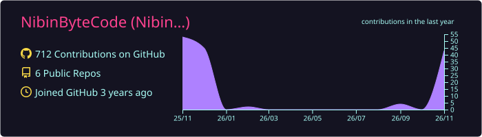
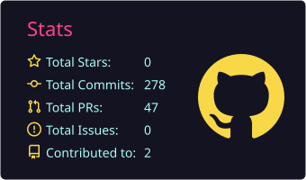
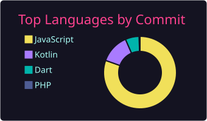
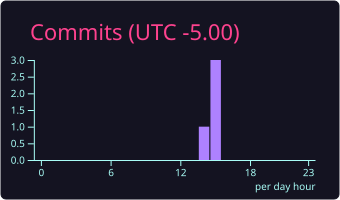

 

---

##  About Me

I build, secure and support **enterprise and government software**, from architecture through production, across **Canada and India**. My core is **C#, .NET and SQL Server**, with **Node.js** services, **Angular / React / Vue** frontends and **Azure** deployments. I also bring AI-assisted development into everyday engineering.

> 🎯 **Looking for:** Senior .NET / Full-Stack Developer roles in Canada
> 🌱 **Currently:** working toward the **Microsoft Azure AI Developer** certification

---

# 💻Tech Stack
                                                           

---

# 📊GitHub Stats :

<!-- These cards are generated daily by .github/workflows/profile-summary-cards.yml and stored in this repo -->

 

 

### 🧰 Most Used Technologies

### ✍️Random Dev Quote

### 😂Random Dev Joke

---

